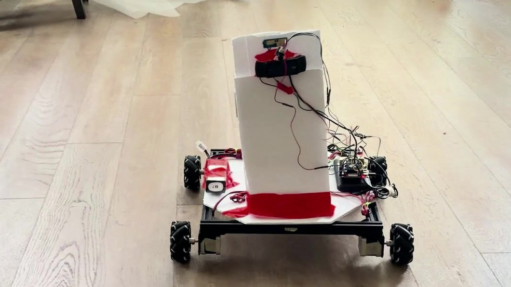

# HOUND Command

**People get trapped under rubble. Wi-Fi passes through walls, and a living body changes it. We built a neural network that
reads that change, a rover that carries it, and this console to run the search.**

**Live:** https://hound-command.vercel.app (Chrome or Edge on a laptop, 1440 pixels wide or more)

The rover is built. The neural network is real and runs in your browser. The disaster, the people and every reading on screen
are a training exercise: simulated, and labelled that way on every screen.



---

## Try it in three minutes

1. Open the site, press **Open the console**, then **Watch the demo** (recommended). **Skip to the console** opens the full instrument.
2. Press the blue button, bottom right, to move through the story: the problem, the idea, the training, the network, the
   rover, the search, the proof, the test.
3. In **The search**, watch a whole mission: a drone survey, the rover driving in, four listening stops, a fan and a hot
   pipe recognised and ruled out, two people found behind walls, a route planned and walked.
4. The second group in the dock is **What comes next**: drone eyes, inside the rubble, many rovers, the collapse, the horizon.
   Do not miss these five.
5. Switch to **Advanced** (top right) for the full instrument: 24 workspaces, with every number, control and drill. **Showcase**,
   bottom right, plays the drone, the rubble scan and the other big scenes from there.

Keys: `⌘K` opens the command palette, the arrow keys move between chapters, `Esc` closes anything.

## Run it yourself

No build step and nothing to install.

```bash
git clone https://github.com/rishith-c/hound-ultra.git && cd hound-ultra && python3 -m http.server 4400
```

Then open http://localhost:4400/ . Every library is in `vendor/` at an exact version, so nothing waits on another site: only the
valley's satellite tiles and one optional Advanced model come from outside. On a computer that cannot draw 3-D, Demo plays
recordings of the same chapters, made from the live console. After one full visit it also works offline.

Checks: open `/tests/` for the unit tests and `/app/?mode=advanced#/status` for the live System check, which runs the same
tests and the fault drills in front of you.

---

## Why

After the Bhote Koshi flood of 26 August 2026, Nepal's disaster authority counted about 1,399 lives lost and about 5,130 people
missing by 15 September. The question in the first hours is always the same: is anyone in there, and where? Wi-Fi
passes through walls, and commercial through-wall radar costs thousands of dollars. HOUND is built from parts a school team can buy.

The exercise in this console is set at Timure in that valley, on real terrain. The block of buildings, the people and the
damage are invented.

## The neural network

- One ESP32-S3 sends 100 Wi-Fi probes a second. A second one on the rover measures how each arrives on 51 subcarriers. This is
  called channel state information.
- A 1-D convolutional network, **23,372 parameters, written from scratch in NumPy** (every gradient by hand, each one checked
  against finite differences), reads a ten second window and answers two questions: is someone there, and are they moving?
- It runs here in JavaScript ([app/core/nn.js](app/core/nn.js)) with the same weights, and matches the Python output on all
  30 bundled test windows.
- **The design decision that mattered:** it is trained on 900 Blender people in a channel simulator that adds the faults of the
  chip (gain jumps, drift, noise, lost packets, jitter). Training on messy signals is what makes it work. You can train a clean and
  a messy version in the browser, in **Advanced → Model forge**.

Measured in simulation, on 955 test windows from simulated people the network never saw. One reading takes 1.1 ms on a laptop.

| | |
|---|---|
| A moving person behind the wall is found | **86.9 %** |
| Still or moving, when someone is there | **91.5 %** |
| An empty room is called empty | **88.9 %** |

The complete table of test results, still people included, is in **Advanced → Wi-Fi AI → Test set**.

HOUND listens, moves, and listens again. It combines Wi-Fi with radar and thermal readings in a Bayesian fusion that writes out
every step, marks a lead "possible" until the evidence is in, and a person confirms.

Over 200 simulated missions with three hidden people and two decoys each: 600 of 600 people were found or flagged for a team
check, 284 of those by sensors alone; no decoy was ever confirmed as a person; the team checked 34 more places on foot and ruled
them out. The radar and thermal likelihoods in that run are design values.

## What is real, what is simulated, what is an idea

Every workspace carries a tag, and **What is real?** (bottom left) lists all of them.

| | |
|---|---|
| **Real and built** | the rover, its drive base CAD, firmware and 400 ms dead-man stop; the neural network and its test results |
| **Real data** | terrain, imagery and map of the valley at Timure |
| **Runs live on simulated input** | the network, sensor fusion, A* route planning, coverage and residual risk, Monte Carlo missions, saliency, in-browser training |
| **Simulated** | the buildings, people, hazards, drone and rover motion; radar, thermal and drone readings |
| **Concept, not built** | the drone, the second and third rover, relay beacons, gas sensing, muon and ground-penetrating scans, and most of **The horizon** |

The console is not connected to the rover. Breathing rate is not shown as a reading, because the network cannot measure it
reliably. Wi-Fi amplitude cannot tell left from right, so position comes from radar. Nothing here is a medical assessment.

## What was built in the event, and what existed before

**Everything in this repository was written during the event**, which opened on 21 November 2026 at 12:00 am PST. The first
commit is from 23 November. The exceptions are the trained weights and test windows in `data/nn.json`, the rover CAD in
`assets/models/rover_cad.glb`, and the photographs of the rover. None of the first console's code is used here.

Made before 21 November 2026: the rover and its firmware, the Wi-Fi simulator and the network with its weights (in an earlier
repository of ours), and a film about the rover. For EvoHacks 2, which closed on 22 November, the team also made a first operator
console: one page with a satellite map, a shake field, a planned route and simulated sensor panels.

## How AI was used to build it

Claude (Anthropic) wrote most of the code, working as a set of command-line agents, each owning one workspace, with one session
directing them. `orchestration/` holds the actual briefs and reports, and `docs/` the rules they had to follow. Codex (OpenAI)
made the textures and illustrations in `assets/img/gen`. A student set the goal, the story, the look and the honesty rules,
and reviewed the results. The physical rover and the original network are the team's own work.

Each agent had to look at its own screens, measure frame rate, and report what it did not check. The numbers above are exported
by [tools/export_eval.py](tools/export_eval.py), which refuses to write if they do not match the published test results.

## How it is put together

Plain ES modules, no framework, no bundler.

- `app/core/` the mission simulator (deterministic: same seed, same mission), Bayesian fusion, planner, network, world model
- `app/twin/` the 3-D site: real terrain, photographed-style materials, film camera, dawn light
- `app/workspaces/` one folder per workspace; `app/shell.js` mounts, hides and frees them
- `app/global/` the opening, command palette, guide, sound, narration, accessibility
- `landing/` the front page; `sw.js` keeps the last good copy for use offline
- `docs/ARCHITECTURE.md` is the contract between modules, `docs/FACTS.md` the list of claims we are allowed to make

## Limits we know about

- No real-world trial. The first one will be a person sitting still behind one drywall wall.
- Wi-Fi alone is strongest on people who move; a still person is found by adding radar and heat, all in simulation so far (full table in Advanced).
- Best on a recent laptop with a real GPU. On integrated graphics the 3-D scenes lower their own resolution.
- Designed for desktop screens.

## Credits

Aerial test photographs: dronepicr, CC BY 2.0, via Wikimedia Commons (credited where shown). Materials and furniture in the film's first shot: Poly Haven, CC0. Terrain: Mapzen terrain tiles on AWS. Imagery: © Esri, Maxar. Map data: © OpenStreetMap contributors (ODbL). three.js (MIT), d3 (ISC),
Rapier (Apache 2.0), Transformers.js (Apache 2.0) and the models it loads under their own licences. Type: Instrument Serif,
Instrument Sans and Geist Mono (SIL OFL). The NEMA 17, Raspberry Pi and Arduino names belong to their owners.

Team HOUND: Rishith Chennupati and teammates.
